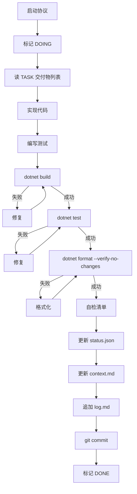

# AGENTS.md — PairMahjong Agent 契约

> 本文件是 AI Agent 执行 PairMahjong 项目的**唯一入口与最高约束**。
> 当本文件与其他文档冲突时，以本文件为准。
> Agent 禁止修改本文件。

---

## 1. 项目概览

```yaml
project: PairMahjong
description: Godot 无服务器四人麻将，支持 P2P 联机与 AI 混合对局
engine: Godot 4.x (.NET)
language: C# 为主，UI 允许 GDScript
dotnet: net8.0
network: WebRTC P2P + 可插拔信令
sync_model: 权威排序 + 确定性重放
serverless: true
```

**任务契约来源**：`docs/plan.md`（Agent 禁止修改）

---

## 2. 启动协议（每次任务必须执行）

Agent 每次启动一个新任务，**必须按顺序**完成以下动作：

1. 读取 `AGENTS.md`（本文件）
2. 读取 `docs/plan.md` 中当前 TASK 的完整章节
3. 读取 `.agent/status.json`
4. 读取 `.agent/context.md`
5. 读取 `.agent/log.md` 最后 30 行
6. 检查 `.agent/blocked.md` 是否存在，若存在则停止
7. 确认当前 TASK 的所有依赖项状态为 `DONE`
8. 进入执行循环

**禁止跳过任何一步。**

---

## 3. 硬性规则（不可违反）

### 3.1 任务范围规则

| 编号 | 规则 |
|---|---|
| R1 | 一次只执行一个 TASK |
| R2 | 只修改当前 TASK「交付物」中列出的文件 |
| R3 | 禁止修改 `docs/plan.md`、`AGENTS.md` |
| R4 | 禁止提前实现后续 TASK 的功能 |
| R5 | 禁止修改其他 TASK 已 DONE 的代码，除非当前 TASK 明确要求 |
| R6 | 需要新增依赖库时，停止并写入 `.agent/blocked.md` |

### 3.2 代码规则

| 编号 | 规则 |
|---|---|
| R7 | `Core`、`Ai`、`Fairness` 层禁止 `using Godot;` |
| R8 | `Core`、`Ai`、`Fairness` 层禁止使用 `float` / `double` 参与规则计算 |
| R9 | 禁止使用 `GD.Print` / `Console.WriteLine` 作为正式日志，使用 `ILogger` |
| R10 | 禁止硬编码绝对路径 |
| R11 | 禁止使用 `Random` 无种子构造、`Guid.NewGuid()` 影响游戏状态 |
| R12 | 禁止使用 `#pragma warning disable`，除非人工批准 |
| R13 | 所有 `public` 方法必须有单元测试 |
| R14 | 禁止留 `TODO` / `FIXME` / `HACK` 在提交代码中 |

### 3.3 测试规则

| 编号 | 规则 |
|---|---|
| R15 | 每个 TASK 必须运行 `dotnet test` 且全部通过 |
| R16 | 覆盖率不得低于 80% |
| R17 | 禁止跳过、禁用、注释掉失败测试 |
| R18 | 禁止修改测试以迁就错误实现 |
| R19 | 测试必须可复现，禁止依赖时间、网络、随机 |

### 3.4 Git 规则

| 编号 | 规则 |
|---|---|
| R20 | 每个 TASK 一个 commit |
| R21 | commit message 格式：`TASK-00X: <简述>` |
| R22 | 禁止 `git push --force` |
| R23 | 禁止 `git reset --hard` 到已推送 commit |
| R24 | 禁止跳过 pre-commit hook |

### 3.5 状态规则

| 编号 | 规则 |
|---|---|
| R25 | 任务开始前必须将 `status.json` 中当前任务置为 `DOING` |
| R26 | 任务完成后必须将 `status.json` 置为 `DONE` 并记录 commit hash |
| R27 | 每次任务完成后必须更新 `context.md` |
| R28 | 每次任务完成后必须追加 `log.md` |
| R29 | 禁止手写 `status.json` 中其他任务的状态 |

---

## 4. 执行循环（每个 TASK 的标准流程）



### 4.1 自检清单（提交前必查）

- [ ] 交付物文件全部存在
- [ ] 只修改了 TASK 范围内的文件
- [ ] `dotnet build` 无错误、无警告
- [ ] `dotnet test` 全部通过
- [ ] 覆盖率 ≥ 80%
- [ ] 无 `TODO` / `FIXME`
- [ ] Core 层无 `using Godot;`
- [ ] 无 `float` / `double` 参与规则
- [ ] `status.json` 已更新
- [ ] `context.md` 已更新
- [ ] `log.md` 已追加
- [ ] commit message 符合格式

任一项不通过，禁止 commit。

---

## 5. 文件边界

### 5.1 允许修改

- 当前 TASK 明确列出的交付物
- `.agent/status.json`
- `.agent/context.md`
- `.agent/log.md`
- `.agent/blocked.md`（仅在阻塞时）

### 5.2 只读

- `AGENTS.md`
- `docs/plan.md`
- `docs/architecture.md`
- `docs/protocol.md`
- `docs/conventions.md`
- 其他 TASK 的源码

### 5.3 禁止创建

- 临时脚本（除非 TASK 要求）
- 未在交付物中列出的源码文件
- 新的 NuGet 依赖（需人工批准）

---

## 6. 代码规范

### 6.1 C# 命名

| 类型 | 规范 | 示例 |
|---|---|---|
| 类 / 结构 | PascalCase | `GameState` |
| 方法 | PascalCase | `Reduce` |
| 属性 | PascalCase | `CurrentPlayer` |
| 字段（私有） | _camelCase | `_wall` |
| 常量 | PascalCase | `TileCount` |
| 枚举值 | PascalCase | `ActionType.Discard` |
| 命名空间 | PascalCase | `PairMahjong.Core` |

### 6.2 文件组织

- 一个文件一个公共类
- 文件名 = 类名
- `namespace` 与目录一致

### 6.3 注释

- 公共 API 必须有 XML 文档注释
- 复杂算法必须有解释
- 禁止无用注释（如 `// increment i`）

### 6.4 分层依赖

```text
Ui / Autoload
    ↓
Net / Session / Fairness
    ↓
Ai
    ↓
Core
```

禁止反向依赖。

---

## 7. 测试规范

### 7.1 结构

```text
tests/
├─ PairMahjong.Core.Tests/
│  ├─ TileTests.cs
│  ├─ ReduceTests.cs
│  └─ HuTests.cs
├─ PairMahjong.Ai.Tests/
└─ PairMahjong.Session.Tests/
```

### 7.2 命名

```csharp
[Fact]
public void Reduce_Discard_RemovesTileFromHand() { }

[Theory]
[InlineData(0)]
[InlineData(33)]
public void Tile_IsValid_ReturnsTrue(int tile) { }
```

### 7.3 覆盖要求

- Core: ≥ 90%
- Ai: ≥ 80%
- Net / Session: ≥ 70%
- Fairness: ≥ 80%

---

## 8. 消息协议约束

所有跨网络消息必须：

1. 使用 `docs/protocol.md` 中定义的 DTO
2. 可 JSON 序列化
3. 带版本号字段（若协议演进）
4. 不包含浮点数
5. 不包含平台相关类型

禁止在消息中使用 `Godot.Collections.Dictionary`（除 RPC 层兼容需要）。

---

## 9. 确定性约束

以下是**强确定性要求**，违反即视为任务失败：

| 约束 | 说明 |
|---|---|
| C1 | 相同输入必须产生相同 `GameState` |
| C2 | 所有随机来自显式种子 |
| C3 | 禁止依赖系统时间、时区、本地化 |
| C4 | 禁止依赖字典遍历顺序 |
| C5 | 禁止依赖浮点运算 |
| C6 | 事件顺序由 `seq` 决定，不由到达顺序决定 |
| C7 | `state_hash` 使用 SHA-256，输入需规范化 |

---

## 10. 失败处理

### 10.1 重试规则

- 同一失败最多重试 3 次
- 每次重试必须记录到 `log.md`
- 3 次失败后必须停止并写 `blocked.md`

### 10.2 触发停止的条件

| 条件 | 处理 |
|---|---|
| 编译失败 3 次 | 写 blocked.md，停止 |
| 测试失败 3 次 | 写 blocked.md，停止 |
| 需求不清 | 写 blocked.md，停止 |
| 需要新依赖 | 写 blocked.md，停止 |
| 需要改 plan.md | 写 blocked.md，停止 |
| 环境问题 | 写 blocked.md，停止 |
| 人工卡点未通过 | 等待人工，禁止继续 |

### 10.3 `blocked.md` 格式

```markdown
# BLOCKED

## 时间
2026-XX-XX HH:MM

## 任务
TASK-XXX

## 问题
<一句话描述>

## 已尝试
1. ...
2. ...
3. ...

## 需要人工决策
<具体问题>

## 相关文件
- path/to/file.cs

## 日志
见 .agent/log.md 最后 50 行
```

---

## 11. 人工卡点

以下任务完成后，Agent 必须**停止并等待人工批准**，禁止自动继续：

| 卡点 | 位置 | 原因 |
|---|---|---|
| C1 | TASK-007 后 | 规则引擎正确性影响全局 |
| C2 | TASK-010 后 | 本地对局能跑通才有意义 |
| C3 | TASK-013 后 | P2P 连接是联机基础 |
| C4 | TASK-015 后 | 联机同步是核心难点 |
| C5 | TASK-018 后 | MVP 完成，需全面验收 |
| C6 | TASK-022 后 | 发布前测试验收 |

到达卡点时：

1. 完成当前 TASK
2. 在 `.agent/log.md` 写入 `WAITING_FOR_HUMAN`
3. 停止执行
4. 等待人工修改 `status.json` 中 `human_approved: true`

---

## 12. 上下文管理

### 12.1 每次任务后必须更新 `context.md`

内容要求：

```markdown
# 当前上下文

## 已完成模块
- <文件>: <关键接口>

## 关键决策
- <决策内容>

## 已知坑
- <坑>

## 下一步
- <下一个 TASK 的注意点>
```

### 12.2 上下文压缩原则

- 只保留接口签名与关键决策
- 不保留实现细节
- 不保留已被取代的方案
- 不超过 200 行

### 12.3 禁止事项

- 禁止凭记忆修改代码
- 禁止依赖对话历史
- 禁止假设未读文件的内容

---

## 13. 日志规范

### 13.1 `log.md` 追加格式

```markdown
## TASK-XXX | <开始时间> | <结束时间>
- 状态: DONE / BLOCKED
- commit: <hash>
- 变更: <简述>
- 测试: <通过数> / <总数>
- 覆盖率: <百分比>
- 备注: <可选>
```

### 13.2 日志容量

- `log.md` 超过 500 行时，归档到 `.agent/log-archive-<date>.md`
- 保留最近 30 天

---

## 14. 禁止事项总表

以下行为**任何情况下**都禁止：

1. 修改 `AGENTS.md` 或 `docs/plan.md`
2. 跳过测试
3. 禁用测试
4. 修改测试以通过
5. 使用未种子化随机
6. 在 Core 层引用 Godot
7. 在规则逻辑中使用浮点
8. 跨 TASK 修改文件
9. 提交含 `TODO` / `FIXME` 的代码
10. 未经批准引入新依赖
11. 未经批准修改协议
12. 使用 `git push --force`
13. 硬编码路径
14. 假装完成（不贴测试输出）
15. 越卡点继续执行

---

## 15. 参考资料

| 文件 | 用途 |
|---|---|
| `docs/plan.md` | 任务契约（最高） |
| `docs/architecture.md` | 架构说明 |
| `docs/protocol.md` | 消息协议真源 |
| `docs/conventions.md` | 编码规范 |
| `.agent/status.json` | 任务状态 |
| `.agent/context.md` | 上下文摘要 |
| `.agent/log.md` | 执行日志 |
| `.agent/blocked.md` | 阻塞记录 |
| DotNet Tools MCP Server | 通过 MCP 调用 dotnet build/test |
| RoslynCodeLens.Mcp | C# 语义分析、诊断、重构、测试覆盖检测 |
| @zoharbabin/webrtc-inspector | WebRTC 调试与故障注入 |

---

## 16. 快速开始

Agent 第一次运行时的最小命令序列：

```bash
# 1. 读取契约
cat AGENTS.md
cat docs/plan.md
cat .agent/status.json

# 2. 找到第一个可执行 TASK
# 依赖已 DONE 且自身为 TODO

# 3. 执行
# 按第 4 节执行循环

# 4. 完成后
git add .
git commit -m "TASK-001: ..."
```

---

## 17. 版本

```yaml
version: 1.0.0
last_updated: 2026-XX-XX
maintainer: human
agent_editable: false
```

**本文件为只读。任何修改必须由人工完成。**