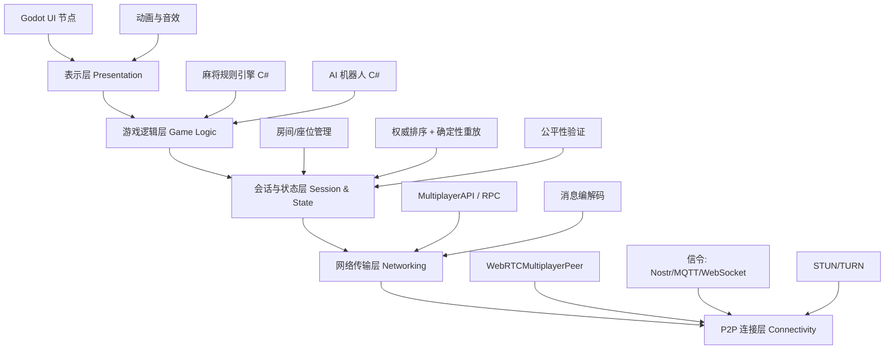

# PairMahjong - Godot 无服务器四人麻将 - Agent 可执行需求规格

## 0. 文档元信息

```yaml
project: PairMahjong
engine: Godot 4.x (.NET)
language: C# (主) / GDScript (允许混合)
dotnet_version: 8.0+
network: WebRTC P2P + 可插拔信令
sync_model: 权威排序 + 确定性重放
serverless: true
server_exception: 信令服务器 / TURN 中继，不参与游戏逻辑
target_platforms: Web, Windows, Android
```

## 1. 项目目标

开发一个四人麻将游戏，满足：

1. 四名真人通过 P2P 联机。
2. 真人可与 AI 机器人混合对局。
3. 单人本地可与三名 AI 对战。
4. 联机中玩家掉线后由 AI 临时接管。
5. 不使用传统游戏服务器。
6. 游戏逻辑不依赖中心服务器。
7. 信令可使用 Nostr、MQTT、WebSocket 最小服务等。
8. TURN 仅作为 NAT 穿透失败时的加密数据中继。

## 2. 非目标

以下内容不属于 MVP：

- 不实现完整日麻/国标全部番型。
- 不实现观战系统。
- 不实现聊天系统。
- 不实现排行榜。
- 不实现账号系统。
- 不实现多阶段加密洗牌，MVP 只做种子承诺。
- 不实现零知识证明。

## 3. 全局约束

### 3.1 技术约束

- 使用 Godot 4.x .NET 版本。
- 主要语言为 C#，允许在 UI 或工具脚本中混合使用 GDScript。
- 使用 .NET 8.0 或更高版本。
- 规则引擎必须是纯 C# 类库，不依赖 `Godot.Node`、`SceneTree`、UI。
- 纯逻辑层（core / ai / fairness）不得引用 `Godot` 命名空间，除 `Vector` 等必要结构外。
- 所有游戏逻辑使用整数或定点数，禁止用 `float`/`double` 参与规则计算。
- 随机数必须使用种子化 `System.Random` 或 `Godot.RandomNumberGenerator`。
- 相同输入必须产生相同输出。
- AI 只能读取 `PlayerView`，不能读取完整 `GameState`。
- 网络消息必须可序列化（`System.Text.Json` 或 Godot `Dictionary`）。
- 所有任务必须有单元测试或验收测试。
- C# 代码遵循 `.editorconfig` 与 `dotnet format`。

### 3.2 语言分工建议

| 层次 | 语言 | 理由 |
|---|---|---|
| core / ai / fairness | C# | 强类型、易测试、可脱离 Godot 运行 |
| net / session | C# | 使用 Godot 的 MultiplayerAPI C# 绑定 |
| ui / scenes | GDScript 或 C# | 视团队偏好，允许混合 |
| 工具脚本 | GDScript | 快速迭代 |

### 3.3 无服务器边界

允许存在：

- 信令服务：只交换 SDP / ICE / 房间信息。
- STUN 服务：NAT 地址发现。
- TURN 服务：只转发加密流量，不解析游戏内容。

禁止存在：

- 保存游戏状态的中心服务器。
- 验证动作的中心服务器。
- 发牌的中心服务器。
- 计算番型的中心服务器。

## 4. 总体架构



## 5. 模块边界

| 模块 | 目录 | 语言 | 职责 | 禁止 |
|---|---|---|---|---|
| core | `scripts/Core/` | C# | 牌、状态、动作、规则、胡牌、番型、reduce | 依赖 Godot.Node、UI、网络 |
| ai | `scripts/Ai/` | C# | AI 决策接口、随机 AI、牌效率 AI | 读取其他玩家手牌 |
| net | `scripts/Net/` | C# | WebRTC 连接、信令、消息收发 | 修改游戏规则 |
| session | `scripts/Net/Session/` | C# | 房间、座位、权威排序、重连 | 直接渲染 UI |
| fairness | `scripts/Fairness/` | C# | 种子承诺、签名、状态哈希 | 参与正常游戏逻辑 |
| ui | `scripts/Ui/` | GDScript/C# | 大厅、牌桌、按钮、动画 | 直接修改 GameState |
| autoload | `scripts/Autoload/` | C# | NetworkManager、GameManager | 承担规则实现 |
| tests | `tests/` | C# | xUnit 单元测试 | 依赖 Godot 运行时 |

## 6. 目录结构

```text
PairMahjong/
├─ addons/
├─ assets/
├─ scenes/
│  ├─ Lobby/
│  ├─ Game/
│  └─ Ui/
├─ scripts/
│  ├─ Autoload/
│  │  ├─ NetworkManager.cs
│  │  └─ GameManager.cs
│  ├─ Core/
│  │  ├─ Tile.cs
│  │  ├─ GameState.cs
│  │  ├─ PlayerState.cs
│  │  ├─ PlayerView.cs
│  │  ├─ Action.cs
│  │  ├─ GameEvent.cs
│  │  ├─ Reduce.cs
│  │  ├─ LegalActions.cs
│  │  ├─ Hu.cs
│  │  ├─ Fan.cs
│  │  ├─ Wall.cs
│  │  └─ Rng.cs
│  ├─ Ai/
│  │  ├─ IBot.cs
│  │  ├─ RandomBot.cs
│  │  └─ EfficiencyBot.cs
│  ├─ Net/
│  │  ├─ ITransport.cs
│  │  ├─ WebRtcTransport.cs
│  │  ├─ Codec.cs
│  │  ├─ Signaling/
│  │  └─ Session/
│  ├─ Fairness/
│  └─ Ui/
├─ tests/
│  ├─ Core.Tests/
│  ├─ Ai.Tests/
│  └─ Session.Tests/
├─ PairMahjong.csproj
├─ PairMahjong.sln
├─ .editorconfig
└─ project.godot
```

## 7. 核心数据模型

### 7.1 牌编码

```csharp
namespace PairMahjong.Core;

// 使用整数编码，保证确定性
// 0-8:   一万到九万
// 9-17:  一筒到九筒
// 18-26: 一索到九索
// 27-33: 东、南、西、北、中、发、白
public static class Tile
{
    public const int Count = 34;

    public static bool IsValid(int tile) => tile >= 0 && tile < Count;
}
```

### 7.2 Action

```csharp
namespace PairMahjong.Core;

public enum ActionType { Discard, Chow, Pong, Kong, Hu, Pass }

public sealed class GameAction
{
    public ActionType Type { get; init; }
    public int PlayerId { get; init; }
    public int Tile { get; init; }
    public IReadOnlyList<int> Tiles { get; init; } = Array.Empty<int>();
}
```

### 7.3 Event

```csharp
namespace PairMahjong.Core;

public sealed class GameEvent
{
    public int Seq { get; init; }
    public string Type { get; init; } = "";
    public int PlayerId { get; init; }
    public Dictionary<string, object> Payload { get; init; } = new();
}
```

### 7.4 GameState

```csharp
namespace PairMahjong.Core;

public sealed class GameState
{
    public int Seed { get; init; }
    public int[] Wall { get; init; } = Array.Empty<int>();
    public PlayerState[] Players { get; init; } = new PlayerState[4];
    public int CurrentPlayer { get; set; }
    public int Turn { get; set; }
    public string Phase { get; set; } = "WAITING_DRAW";
    public int LastDiscard { get; set; } = -1;
    public List<GameEvent> Events { get; init; } = new();
}
```

### 7.5 PlayerView

```csharp
namespace PairMahjong.Core;

public sealed class PlayerView
{
    public int MySeat { get; init; }
    public IReadOnlyList<int> MyHand { get; init; } = Array.Empty<int>();
    public IReadOnlyList<Meld> MyMelds { get; init; } = Array.Empty<Meld>();
    public IReadOnlyList<IReadOnlyList<int>> Discards { get; init; } = Array.Empty<IReadOnlyList<int>>();
    public IReadOnlyList<int> Scores { get; init; } = Array.Empty<int>();
    public int CurrentPlayer { get; init; }
    public int LastDiscard { get; init; }
    public IReadOnlyList<GameAction> LegalActions { get; init; } = Array.Empty<GameAction>();
}
```

## 8. 消息协议

统一使用 `Dictionary<string, object>` 或强类型 DTO + `System.Text.Json`。

### 8.1 客户端到房主

```csharp
public sealed record JoinMessage(string Type, string RoomId, int PeerId, string Nickname);
public sealed record ReadyMessage(string Type, bool Ready);
public sealed record ActionMessage(string Type, int Seq, int PlayerId, GameAction Action, string? Signature);
public sealed record SyncRequestMessage(string Type, int LastSeq);
public sealed record ReconnectMessage(string Type, int PlayerId);
public sealed record PingMessage(string Type, long Ts);
```

### 8.2 房主到客户端

```csharp
public sealed record RoomStateMessage(string Type, IReadOnlyList<PlayerInfo> Players, int HostId);
public sealed record EventMessage(string Type, int Seq, GameEvent Event, string StateHash);
public sealed record SyncStateMessage(string Type, GameState State, int Seq);
public sealed record ErrorMessage(string Type, string Code, string Message);
public sealed record PongMessage(string Type, long Ts);
```

## 9. 任务拆分

> 每个任务格式统一。Agent 必须按依赖顺序执行。  
> 完成任务后更新状态：`TODO -> DOING -> DONE`。  
> 每个任务完成后必须运行对应测试。

---

### TASK-001: Godot .NET 工程初始化

- 阶段: 基础
- 优先级: P0
- 依赖: 无
- 目标: 创建 Godot 4.x .NET 项目与目录结构。
- 交付物:
  - `project.godot`
  - `PairMahjong.csproj`
  - `PairMahjong.sln`
  - 第 6 节目录结构
  - `.editorconfig`
- 实现要点:
  1. 使用 Godot 4.x .NET 版本创建项目。
  2. 建立 `scripts/Core`、`scripts/Ai`、`scripts/Net`、`scripts/Ui`。
  3. 配置 `<TargetFramework>net8.0</TargetFramework>`。
  4. 配置 `dotnet format`。
  5. 配置输入映射占位。
- 验收标准:
  - Godot 可打开项目。
  - `dotnet build` 成功。
  - 空场景可运行。
- 测试要求:
  - 运行项目无报错。
- 禁止事项:
  - 不实现游戏逻辑。

---

### TASK-002: 核心类型与常量

- 阶段: 基础
- 优先级: P0
- 依赖: TASK-001
- 目标: 实现 `Tile`、`GameAction`、`GameEvent`、`GameState`、`PlayerView`。
- 交付物:
  - `scripts/Core/Tile.cs`
  - `scripts/Core/Action.cs`
  - `scripts/Core/Event.cs`
  - `scripts/Core/GameState.cs`
  - `scripts/Core/PlayerView.cs`
- 实现要点:
  1. 使用整数编码 0-33。
  2. 使用 `sealed class` 或 `record`。
  3. 序列化使用 `System.Text.Json`。
  4. core 层不引用 `Godot` 命名空间。
- 验收标准:
  - 所有类型可实例化。
  - 可 JSON 序列化与反序列化。
- 测试要求:
  - xUnit 测试覆盖序列化往返。
- 禁止事项:
  - 不使用 `float`/`double` 表示牌或分数。
  - core 层禁止 `using Godot;`。

---

### TASK-003: 确定性随机与洗牌

- 阶段: 基础
- 优先级: P0
- 依赖: TASK-002
- 目标: 实现种子化随机、洗牌、牌墙生成。
- 交付物:
  - `scripts/Core/Rng.cs`
  - `scripts/Core/Wall.cs`
- 实现要点:
  1. 使用 `System.Random` 并显式传入 seed。
  2. `seed` 必须可复现。
  3. 洗牌使用 Fisher-Yates。
  4. 牌墙为 `int[]`。
- 验收标准:
  - 相同种子生成相同牌墙。
  - 不同种子牌墙不同。
- 测试要求:
  - 固定种子快照测试。
- 禁止事项:
  - 禁止使用 `Guid.NewGuid()` 或全局随机。

---

### TASK-004: 玩家状态与手牌

- 阶段: 基础
- 优先级: P0
- 依赖: TASK-002
- 目标: 实现玩家手牌、副露、牌河、分数。
- 交付物:
  - `scripts/Core/PlayerState.cs`
  - `scripts/Core/Meld.cs`
- 实现要点:
  1. 手牌排序。
  2. 副露结构：吃、碰、杠。
  3. 牌河记录。
  4. 分数为整数。
- 验收标准:
  - 可添加、移除手牌。
  - 可判断副露合法性。
- 测试要求:
  - 手牌增删测试。
- 禁止事项:
  - 不实现胡牌判断。

---

### TASK-005: 动作合法性与 reduce

- 阶段: 基础
- 优先级: P0
- 依赖: TASK-003, TASK-004
- 目标: 实现 `Reduce(GameState, GameEvent) -> GameState` 与动作合法性。
- 交付物:
  - `scripts/Core/Reduce.cs`
  - `scripts/Core/LegalActions.cs`
- 实现要点:
  1. 摸牌、打牌、吃、碰、杠、胡。
  2. 状态机：WAITING_DRAW, WAITING_DISCARD, WAITING_ACTION, END。
  3. 事件溯源：只通过 `GameEvent` 改变状态。
  4. 纯函数，无副作用。
- 验收标准:
  - 可模拟完整回合。
  - 非法动作被拒绝。
- 测试要求:
  - 每个动作至少 2 个测试用例。
- 禁止事项:
  - 不在 reduce 中发网络消息。
  - 不引用 Godot。

---

### TASK-006: 胡牌与番型

- 阶段: 基础
- 优先级: P0
- 依赖: TASK-005
- 目标: 实现胡牌判断与简化番型。
- 交付物:
  - `scripts/Core/Hu.cs`
  - `scripts/Core/Fan.cs`
- 实现要点:
  1. 标准胡：4 面子 + 1 将。
  2. 七对子可选。
  3. 番型先做：平胡、碰碰胡、清一色、自摸、点炮。
  4. 返回番数与分数。
- 验收标准:
  - 已知牌型判定正确。
  - 番型计算正确。
- 测试要求:
  - 胡牌测试集不少于 30 个。
- 禁止事项:
  - 不实现复杂日麻役种。

---

### TASK-007: 规则引擎单元测试

- 阶段: 基础
- 优先级: P0
- 依赖: TASK-006
- 目标: 为规则引擎建立完整测试。
- 交付物:
  - `tests/Core.Tests/` xUnit 项目
- 实现要点:
  1. 测试牌墙、发牌、动作、胡牌、番型。
  2. 使用固定种子。
  3. 使用 `coverlet` 收集覆盖率。
- 验收标准:
  - 所有 P0 逻辑测试通过。
  - 覆盖率不低于 80%。
- 测试要求:
  - `dotnet test`
- 禁止事项:
  - 不跳过失败测试。

---

### TASK-008: AI 接口与随机 AI

- 阶段: AI
- 优先级: P0
- 依赖: TASK-006
- 目标: 定义 Bot 接口并实现随机 AI。
- 交付物:
  - `scripts/Ai/IBot.cs`
  - `scripts/Ai/RandomBot.cs`
- 实现要点:
  1. `GameAction Decide(PlayerView view)`。
  2. 只读取 `PlayerView`。
  3. 随机 AI 从合法动作中选择。
- 验收标准:
  - AI 可完成整局。
  - 不产生非法动作。
- 测试要求:
  - AI 对 AI 模拟 100 局无崩溃。
- 禁止事项:
  - 不读取完整 GameState。

---

### TASK-009: 牌效率 AI

- 阶段: AI
- 优先级: P1
- 依赖: TASK-008
- 目标: 实现基于向听数与有效进张的 AI。
- 交付物:
  - `scripts/Ai/EfficiencyBot.cs`
- 实现要点:
  1. 计算向听数。
  2. 计算有效进张。
  3. 优先打安全牌。
  4. 可配置难度。
- 验收标准:
  - 比随机 AI 胜率高。
  - 决策耗时小于 100ms。
- 测试要求:
  - 与随机 AI 对战 100 局，胜率 > 60%。
- 禁止事项:
  - 不进行无限搜索。

---

### TASK-010: 本地游戏循环

- 阶段: 本地
- 优先级: P0
- 依赖: TASK-007, TASK-009
- 目标: 实现单机 1 真人 + 3 AI 或 4 AI 对局。
- 交付物:
  - `scripts/Autoload/GameManager.cs`
  - `scenes/Game/LocalGame.tscn`
- 实现要点:
  1. 事件日志驱动。
  2. 支持热座。
  3. 支持 AI 托管。
  4. 支持回放。
- 验收标准:
  - 可完整打一局。
  - 可回放事件日志。
- 测试要求:
  - 自动模拟 100 局无死锁。
- 禁止事项:
  - 不接入网络。

---

### TASK-011: 最小本地 UI

- 阶段: 本地
- 优先级: P1
- 依赖: TASK-010
- 目标: 显示手牌、牌河、按钮。
- 交付物:
  - `scenes/Game/Table.tscn`
  - `scripts/Ui/TableUi.cs` 或 `.gd`
- 实现要点:
  1. 手牌用 `TextureRect` 或 `Button`。
  2. 吃碰杠胡按钮。
  3. 倒计时。
- 验收标准:
  - 可点击出牌。
  - 可完成一局。
- 测试要求:
  - 手动验收。
- 禁止事项:
  - UI 不直接改状态，只发送 GameAction。

---

### TASK-012: 网络抽象与信令接口

- 阶段: 网络
- 优先级: P0
- 依赖: TASK-001
- 目标: 定义网络传输抽象与信令接口。
- 交付物:
  - `scripts/Net/ITransport.cs`
  - `scripts/Net/Codec.cs`
  - `scripts/Net/Signaling/ISignaling.cs`
- 实现要点:
  1. `ConnectToPeer(int peerId)`。
  2. `Send(int peerId, byte[] data)`。
  3. `Broadcast(byte[] data)`。
  4. `event Action<int, byte[]> OnMessage`。
  5. 信令可插拔：Nostr、MQTT、WebSocket。
- 验收标准:
  - 接口可编译。
  - 有 Mock 实现。
- 测试要求:
  - Mock 传输测试。
- 禁止事项:
  - 不绑定具体信令实现。

---

### TASK-013: WebRTCMultiplayerPeer 全互连

- 阶段: 网络
- 优先级: P0
- 依赖: TASK-012
- 目标: 使用 Godot WebRTC 建立四人全互连。
- 交付物:
  - `scripts/Net/WebRtcTransport.cs`
  - `scripts/Autoload/NetworkManager.cs`
- 实现要点:
  1. `WebRTCMultiplayerPeer.CreateMesh()`。
  2. 创建 DataChannel。
  3. 交换 SDP / ICE。
  4. 配置 STUN，可选 TURN。
  5. 使用 `MultiplayerAPI` 和 `[Rpc]` 特性。
- 验收标准:
  - 两个浏览器可互发消息。
  - 四个浏览器可广播消息。
- 测试要求:
  - 本机双实例测试。
  - 局域网两台设备测试。
- 禁止事项:
  - 不把游戏逻辑放入网络层。

---

### TASK-014: 房间会话管理

- 阶段: 网络
- 优先级: P0
- 依赖: TASK-013
- 目标: 实现房间创建、加入、准备、开始。
- 交付物:
  - `scripts/Net/Session/Room.cs`
  - `scripts/Net/Session/SessionManager.cs`
- 实现要点:
  1. `CREATE_ROOM`、`JOIN_ROOM`、`READY`、`START`。
  2. 座位分配：东南西北。
  3. 房主为 Host。
  4. 玩家列表同步。
- 验收标准:
  - 四人可进入同一房间。
  - 准备后房主可开始。
- 测试要求:
  - 模拟四客户端加入。
- 禁止事项:
  - 不实现游戏规则。

---

### TASK-015: 权威排序 + 确定性重放

- 阶段: 网络
- 优先级: P0
- 依赖: TASK-010, TASK-014
- 目标: 四人联机可打完整一局。
- 交付物:
  - `scripts/Net/Session/Authority.cs`
  - `scripts/Net/Session/Sync.cs`
- 实现要点:
  1. 房主接收 `ActionMessage`。
  2. 房主验证后分配 `seq`。
  3. 房主广播 `EventMessage`。
  4. 客户端按 `seq` 调用 `Reduce`。
  5. 所有客户端运行相同规则引擎。
- 验收标准:
  - 四人可完成一局。
  - 所有客户端状态一致。
- 测试要求:
  - 四实例联机测试。
  - 乱序消息测试。
- 禁止事项:
  - 客户端不自行改变权威状态。

---

### TASK-016: 状态哈希与分叉检测

- 阶段: 网络
- 优先级: P1
- 依赖: TASK-015
- 目标: 检测客户端状态不一致。
- 交付物:
  - `scripts/Fairness/StateHash.cs`
- 实现要点:
  1. 每次事件后计算 `state_hash`。
  2. 广播哈希。
  3. 不一致时请求 `SYNC_STATE`。
  4. 使用 SHA-256。
- 验收标准:
  - 可检测人为篡改。
  - 可自动重新同步。
- 测试要求:
  - 篡改状态测试。
- 禁止事项:
  - 不忽略哈希不一致。

---

### TASK-017: 重连与同步

- 阶段: 网络
- 优先级: P1
- 依赖: TASK-016
- 目标: 掉线玩家可重连并恢复。
- 交付物:
  - `scripts/Net/Session/Reconnect.cs`
- 实现要点:
  1. 心跳 `PING` / `PONG`。
  2. 超时 5 秒标记掉线。
  3. `SYNC_REQUEST(last_seq)`。
  4. 房主返回 `SYNC_STATE` 或重放事件。
- 验收标准:
  - 掉线后重连成功。
  - 状态与房主一致。
- 测试要求:
  - 模拟断线重连。
- 禁止事项:
  - 不丢失事件。

---

### TASK-018: AI 补位

- 阶段: 网络
- 优先级: P1
- 依赖: TASK-009, TASK-017
- 目标: 玩家掉线后由 AI 接管。
- 交付物:
  - `scripts/Net/Session/AiTakeover.cs`
- 实现要点:
  1. 房主检测掉线。
  2. 房主启动本地 AI。
  3. AI 决策后由房主广播 `EventMessage`。
  4. UI 显示“AI 托管中”。
- 验收标准:
  - 掉线后游戏继续。
  - 玩家回来后可恢复控制。
- 测试要求:
  - 模拟掉线 30 秒。
- 禁止事项:
  - AI 不读取其他玩家手牌。

---

### TASK-019: 洗牌承诺

- 阶段: 公平性
- 优先级: P1
- 依赖: TASK-003, TASK-014
- 目标: 防止房主单方面控制牌墙。
- 交付物:
  - `scripts/Fairness/Commit.cs`
- 实现要点:
  1. 每位玩家生成 `seed` 和 `salt`。
  2. 广播 `SHA256(seed + salt)`。
  3. 开局后揭示。
  4. 组合所有种子生成最终牌墙。
- 验收标准:
  - 无法在揭示后更换种子。
  - 相同种子组合生成相同牌墙。
- 测试要求:
  - 承诺验证测试。
- 禁止事项:
  - 不实现多阶段加密洗牌。

---

### TASK-020: 操作签名

- 阶段: 公平性
- 优先级: P2
- 依赖: TASK-015
- 目标: 防止玩家抵赖操作。
- 交付物:
  - `scripts/Fairness/Signature.cs`
- 实现要点:
  1. 使用 `System.Security.Cryptography` 的 Ed25519。
  2. 对 `GameAction` 签名。
  3. 广播时附带签名。
- 验收标准:
  - 篡改动作可被检测。
- 测试要求:
  - 签名验证测试。
- 禁止事项:
  - 不阻塞正常游戏。

---

### TASK-021: 牌桌 UI

- 阶段: UI
- 优先级: P1
- 依赖: TASK-011, TASK-015
- 目标: 完成可玩的联机牌桌界面。
- 交付物:
  - `scenes/Game/Table.tscn`
  - `scripts/Ui/TableUi.cs`
  - `scripts/Ui/LobbyUi.cs`
- 实现要点:
  1. 大厅：创建、加入、单机。
  2. 房间：玩家列表、准备、开始。
  3. 牌桌：手牌、牌河、副露、分数、按钮。
  4. 动画与音效。
  5. 移动端适配。
- 验收标准:
  - 新用户可独立完成一局。
  - 移动端可操作。
- 测试要求:
  - 手动验收 + 截图。
- 禁止事项:
  - UI 不直接修改 GameState。

---

### TASK-022: 集成测试与网络模拟

- 阶段: 测试
- 优先级: P1
- 依赖: TASK-021
- 目标: 模拟延迟、丢包、断线、重连。
- 交付物:
  - `tests/Session.Tests/` 集成测试
- 实现要点:
  1. 两客户端、四客户端测试。
  2. 延迟注入。
  3. 丢包注入。
  4. 断线重连测试。
- 验收标准:
  - 游戏在弱网下可恢复。
  - 无状态分叉。
- 测试要求:
  - 自动化集成测试。
- 禁止事项:
  - 不跳过网络异常测试。

---

### TASK-023: 导出与部署

- 阶段: 发布
- 优先级: P1
- 依赖: TASK-022
- 目标: 导出 Web、Windows、Android。
- 交付物:
  - 导出预设
  - 部署说明
- 实现要点:
  1. Web 导出使用 WebRTC。
  2. 桌面端安装 `webrtc-native`。
  3. 配置信令服务。
  4. 可选 TURN。
- 验收标准:
  - Web 可访问。
  - 桌面端可运行。
  - 四人可联机。
- 测试要求:
  - 跨平台联机测试。
- 禁止事项:
  - 不依赖中心游戏服务器。

---

### TASK-024: 文档与 Agent 状态更新

- 阶段: 发布
- 优先级: P2
- 依赖: TASK-023
- 目标: 更新 README、架构文档、任务状态。
- 交付物:
  - `README.md`
  - `docs/architecture.md`
  - `docs/protocol.md`
- 实现要点:
  1. 说明如何运行、测试、部署。
  2. 记录消息协议。
  3. 更新任务看板。
- 验收标准:
  - 新开发者可按文档运行。
- 测试要求:
  - 文档链接检查。
- 禁止事项:
  - 不保留过期说明。

## 10. 任务状态看板

| 任务 ID | 名称 | 状态 | 负责人 | 依赖 |
|---|---|---|---|---|
| TASK-001 | Godot .NET 工程初始化 | TODO | Agent | 无 |
| TASK-002 | 核心类型与常量 | TODO | Agent | TASK-001 |
| TASK-003 | 确定性随机与洗牌 | TODO | Agent | TASK-002 |
| TASK-004 | 玩家状态与手牌 | TODO | Agent | TASK-002 |
| TASK-005 | 动作合法性与 reduce | TODO | Agent | TASK-003,004 |
| TASK-006 | 胡牌与番型 | TODO | Agent | TASK-005 |
| TASK-007 | 规则引擎单元测试 | TODO | Agent | TASK-006 |
| TASK-008 | AI 接口与随机 AI | TODO | Agent | TASK-006 |
| TASK-009 | 牌效率 AI | TODO | Agent | TASK-008 |
| TASK-010 | 本地游戏循环 | TODO | Agent | TASK-007,009 |
| TASK-011 | 最小本地 UI | TODO | Agent | TASK-010 |
| TASK-012 | 网络抽象与信令接口 | TODO | Agent | TASK-001 |
| TASK-013 | WebRTCMultiplayerPeer 全互连 | TODO | Agent | TASK-012 |
| TASK-014 | 房间会话管理 | TODO | Agent | TASK-013 |
| TASK-015 | 权威排序 + 确定性重放 | TODO | Agent | TASK-010,014 |
| TASK-016 | 状态哈希与分叉检测 | TODO | Agent | TASK-015 |
| TASK-017 | 重连与同步 | TODO | Agent | TASK-016 |
| TASK-018 | AI 补位 | TODO | Agent | TASK-009,017 |
| TASK-019 | 洗牌承诺 | TODO | Agent | TASK-003,014 |
| TASK-020 | 操作签名 | TODO | Agent | TASK-015 |
| TASK-021 | 牌桌 UI | TODO | Agent | TASK-011,015 |
| TASK-022 | 集成测试与网络模拟 | TODO | Agent | TASK-021 |
| TASK-023 | 导出与部署 | TODO | Agent | TASK-022 |
| TASK-024 | 文档与 Agent 状态更新 | TODO | Agent | TASK-023 |

## 11. Agent 执行协议

1. 读取本文件。
2. 选择状态为 `TODO` 且依赖已 `DONE` 的任务。
3. 将任务状态改为 `DOING`。
4. 只实现该任务范围内代码。
5. 编写或更新测试。
6. 运行测试（`dotnet test`）。
7. 测试通过后，将任务状态改为 `DONE`。
8. 更新任务状态看板。
9. 进入下一个任务。

## 12. 完成定义

一个任务只有同时满足以下条件才算完成：

- 交付物存在。
- `dotnet build` 成功。
- Godot 可打开项目。
- 测试通过。
- 验收标准满足。
- 没有违反禁止事项。
- 任务状态看板已更新。

## 13. MVP 范围

MVP 必须包含：

- TASK-001 到 TASK-018。
- 简化麻将规则。
- 单机 1 真人 + 3 AI。
- 四人 P2P 联机。
- 权威排序 + 确定性重放。
- 掉线 AI 补位。
- 基础 UI。
- 种子承诺。

MVP 可以暂缓：

- TASK-019 之后的高级公平性。
- 复杂番型。
- 多阶段加密洗牌。
- 排行榜、账号、聊天。

## 14. C# 与 Godot 集成要点

### 14.1 项目文件

`PairMahjong.csproj` 顶层示例：

```xml
<Project Sdk="Godot.NET.Sdk/4.x.x">
  <PropertyGroup>
    <TargetFramework>net8.0</TargetFramework>
    <Nullable>enable</Nullable>
    <LangVersion>12</LangVersion>
    <EnableDynamicLoading>true</EnableDynamicLoading>
  </PropertyGroup>
</Project>
```

### 14.2 纯逻辑层与 Godot 解耦

- `scripts/Core`、`scripts/Ai`、`scripts/Fairness` 不引用 `Godot` 命名空间。
- 可将这些目录独立为 `PairMahjong.Core.csproj` 类库，方便用 xUnit 直接测试。
- Godot 层（`Autoload`、`Net`、`Ui`）引用 `Core` 项目。

推荐最终工程结构：

```text
PairMahjong/
├─ PairMahjong.sln
├─ PairMahjong.csproj              (Godot 项目)
├─ src/
│  ├─ PairMahjong.Core/            (纯 C# 类库)
│  │  ├─ PairMahjong.Core.csproj
│  │  ├─ Tile.cs
│  │  ├─ Reduce.cs
│  │  └─ ...
│  ├─ PairMahjong.Ai/              (纯 C# 类库)
│  └─ PairMahjong.Fairness/        (纯 C# 类库)
├─ scripts/                        (Godot 相关 C#)
│  ├─ Autoload/
│  ├─ Net/
│  └─ Ui/
└─ tests/
   ├─ PairMahjong.Core.Tests/
   ├─ PairMahjong.Ai.Tests/
   └─ PairMahjong.Session.Tests/
```

### 14.3 RPC 写法

```csharp
using Godot;

public partial class NetworkManager : Node
{
    [Rpc(MultiplayerApi.RpcMode.AnyPeer, CallLocal = true, TransferMode = MultiplayerPeer.TransferModeEnum.Reliable)]
    public void SendPlayerAction(Godot.Collections.Dictionary action)
    {
        // 处理玩家动作
    }
}
```

### 14.4 信号写法

```csharp
[Signal]
public delegate void MessageReceivedEventHandler(int peerId, byte[] data);
```

### 14.5 测试运行

- 纯逻辑测试：`dotnet test`
- Godot 场景测试：使用 gdUnit4（支持 C#）或 GUT 做冒烟测试。
- 覆盖率：`dotnet test --collect:"XPlat Code Coverage"`

### 14.6 注意事项

- Godot C# 使用 `partial class` 且继承 `Node` 的类必须与场景文件名匹配。
- 不要在纯逻辑层使用 `GD.Print`，改用 `ILogger` 或自定义日志接口。
- Web 导出时，C# 版本的 WebRTC 支持需要验证 Godot 4.x .NET 的浏览器导出兼容性；若不支持，可在 Web 平台使用 GDScript 网络层 + C# 逻辑层。
- 打包体积会因 .NET 运行时增加，Web 端注意裁剪（trimming）。